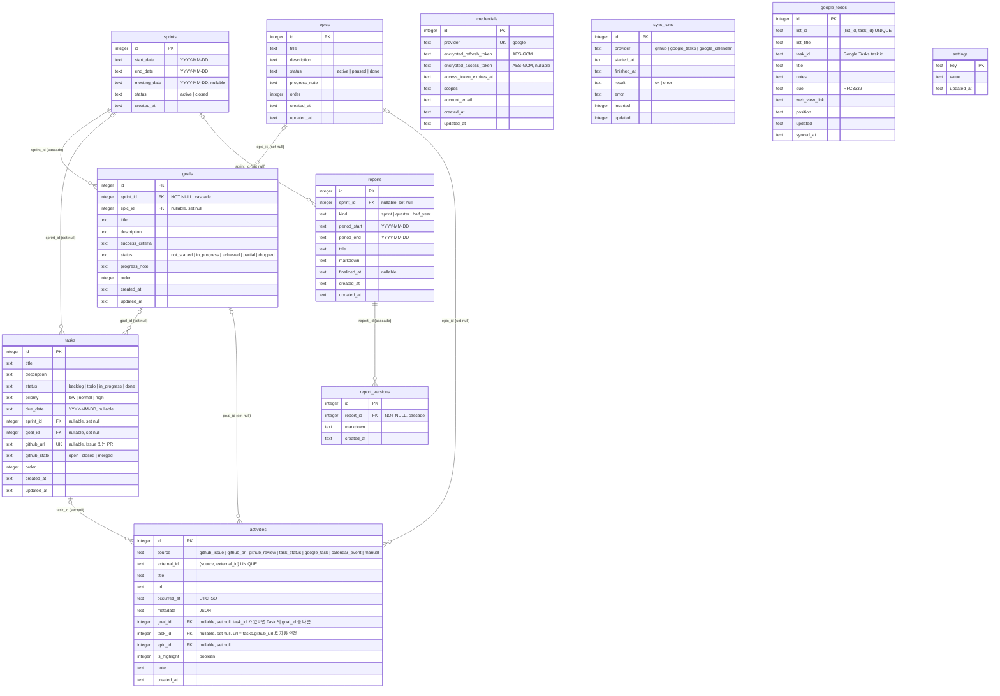

# Mizuyari ERD

D1(SQLite) 스키마의 엔티티 관계도. 실제 컬럼 정의는 [`src/worker/db/schema.ts`](../src/worker/db/schema.ts) 가 기준이고, 이 문서는 스키마를 바꿀 때 함께 갱신한다.

- 날짜만 저장하는 컬럼(`*_date`, `period_*`)은 `YYYY-MM-DD` 텍스트, 시각(`*_at`)은 UTC ISO 8601 텍스트.
- `status`·`kind`·`source` 같은 열거형은 `text` 컬럼이며 허용값은 [`src/shared/types.ts`](../src/shared/types.ts) 의 상수 배열과 같다.
- FK 는 모두 `integer` 이고, 부모가 지워질 때의 동작은 관계선 라벨에 적었다.

## 다이어그램

## 테이블 요약

| 테이블 | 역할 | 고유 제약 | 인덱스 |
| --- | --- | --- | --- |
| `epics` | 스프린트를 넘어 이어지는 긴 목표 | — | — |
| `sprints` | 2주 단위 기간 | — | `start_date` |
| `goals` | 스프린트별 목표. Epic 에 붙거나 단발성 | — | `sprint_id`, `epic_id` |
| `tasks` | 칸반 작업 단위. GitHub Issue/PR 과 1:1 연결 가능 | `github_url` | `sprint_id`, `goal_id`, `status` |
| `activities` | 수집·수동 입력된 활동을 출처와 무관하게 통합 | `(source, external_id)` | `occurred_at`, `goal_id`, `epic_id`, `task_id` |
| `reports` | 리포트 본문(sprint / quarter / half_year) | — | `(period_start, period_end)`, `sprint_id` |
| `report_versions` | 확정 전 저장할 때마다 쌓이는 리포트 이력 | — | `report_id` |
| `credentials` | Google OAuth 토큰(암호화). 고정 비밀은 Workers Secrets | `provider` | — |
| `sync_runs` | 수집 실행 로그 | — | `(provider, started_at)` |
| `google_todos` | 미완료 Google TODO 스냅샷 | `(list_id, task_id)` | `due` |
| `settings` | 수집 커서와 소규모 설정값(key-value) | `key` (PK) | — |

## 관계와 운용 규칙

- **Epic → Goal → Task → Activity** 가 중심 흐름이다. Goal 은 반드시 Sprint 에 속하지만 Epic 은 선택이고, Task 와 Activity 의 상위 연결은 모두 nullable 이다. 활동은 Goal 없이 Epic 에 직접 붙을 수도 있다.
- **삭제 전파**: Sprint 를 지우면 그 Goal 이 함께 지워지고(cascade), Report 를 지우면 버전 이력이 함께 지워진다. 그 외 FK 는 모두 `set null` 이라 부모를 지워도 Task·Activity·Report 행은 남는다.
- **활동 upsert**: `(source, external_id)` 로 식별한다. 수집기는 제목·URL·시각만 갱신하고 사용자가 붙인 `goal_id`·`epic_id`·`note`·`is_highlight` 는 건드리지 않는다.
- **Task 와 활동의 연결**: `activities.url = tasks.github_url` 인 GitHub 활동(`github_issue`·`github_pr`·`github_review`)은 동기화 뒤마다 `task_id` 가 채워진다(`linkActivitiesToTasks`, 멱등). `task_id` 가 있는 활동의 `goal_id` 는 Task 의 `goal_id` 를 그대로 따르는 파생값이라 활동 쪽에서는 바꾸지 않는다(API 는 409). Task 의 목표를 바꾸면 연결된 활동 전부가 따라간다. Task 가 지워지면 `task_id` 만 null 이 되고 `goal_id` 는 남아 일반 활동처럼 편집할 수 있다.
- **Task 완료 기록**: `github_url` 이 없는 Task 만 done 이 될 때 `activities(source = task_status, external_id = "<task_id>:done")` 를 남긴다. GitHub 연결 Task 는 수집된 Issue closed / PR merged 활동이 완료 기록을 대신한다.
- **스프린트 이월과 Task**: Task 는 이월 때 복사되지 않는다. Board 에서 Task 의 목표를 다음 스프린트 목표로 옮기면 그 Task 의 활동 전부가 새 목표로 이동하므로, 이전 스프린트 리포트는 확정한 뒤에 옮기는 것을 전제로 한다. 확정된 리포트 markdown 은 영향을 받지 않는다.
- **Google TODO 이동**: 미완료 TODO 는 `google_todos` 에만 있고, 완료되면 `activities(source = google_task)` 로 옮겨지며 스냅샷에서 지워진다. 완료 취소 시 반대로 되돌린다. 같은 TODO 가 두 테이블에 동시에 있으면 안 된다.
- **settings 키**: `sync:<provider>:last_success` (수집 커서), `calendar:exclude_keywords`, `calendar:palette`, `calendar:color_labels`, `migrate:task_link_v1` (중복 `task_status` 정리를 한 번만 돌린 표시), `migrate:github_closed_issues_v1` (닫힌 할당 Issue 30일 백필을 한 번만 돌린 표시).
- **credentials** 는 현재 `provider = "google"` 한 행만 쓴다. `ENCRYPTION_KEY` 를 바꾸면 복호화할 수 없으므로 Google 재연결이 필요하다.
